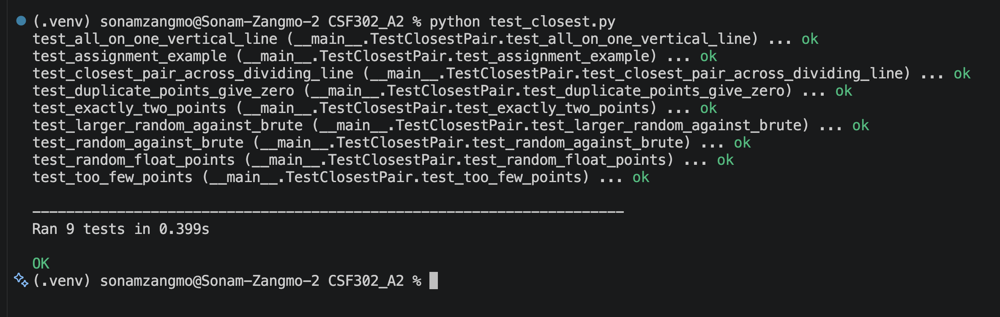
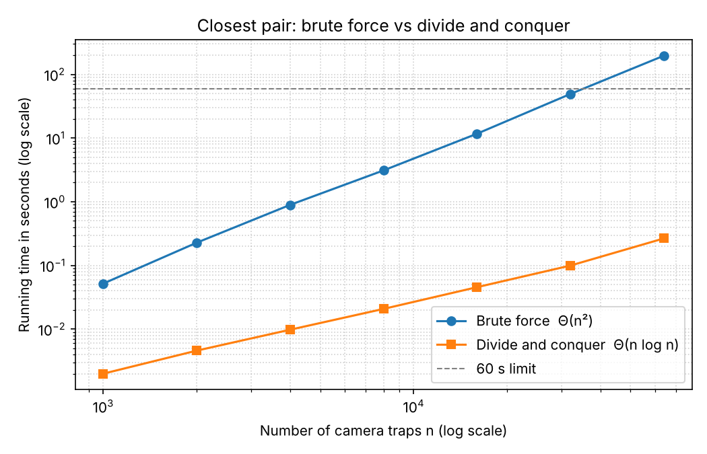
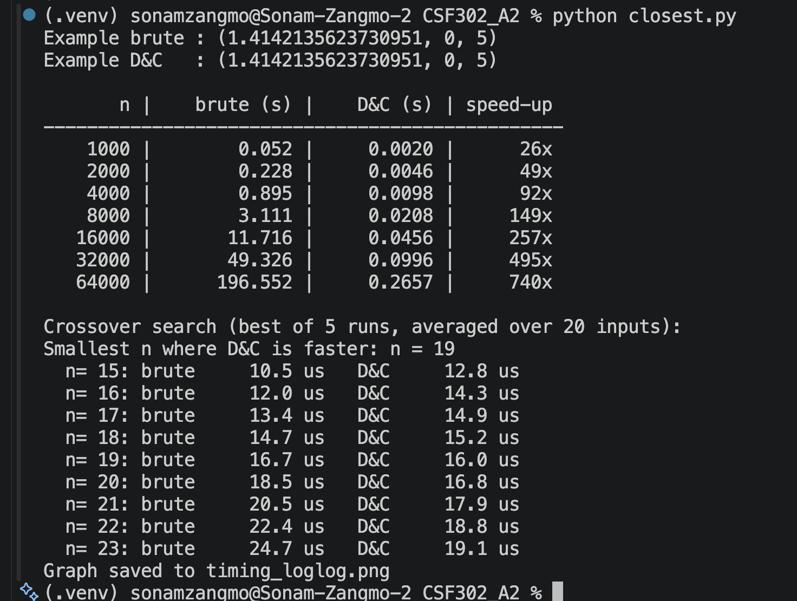

# CSF302 Assignment 2: Closest Camera Traps

**Sonam Zangmo | Student ID: 02240365 | BE3SWE**

📄 **Full report (PDF):** [CSF302_02240365_A2.pdf](CSF302_02240365_A2.pdf)


**AI tool declaration:** I used Claude (Anthropic) to help structure the code, suggest test cases and improve the wording of this report. I ran every program myself, checked the divide-and-conquer output against my brute-force version (all tests pass), and all timings below are from my own machine.

## Part A: Implementation (closest.py)

**closest_pair_brute(points):** two nested loops compare every pair i \< j and keep the smallest distance. It does n(n−1)/2 comparisons, so it is Θ(n²).

**closest_pair(points):** divide and conquer, following the method in Unit 4.1:

- **Pre-sort once:** point indices are sorted by x and by y (O(n log n)). Indices are used so the answer reports the original positions i and j.

- **Divide:** split the x-sorted list at the middle; the y-sorted list is split into the same two halves (by index membership, so duplicate x values are handled).

- **Conquer:** solve each half recursively; base case n ≤ 3 is solved directly. δ = the smaller answer.

- **Combine:** take the points within δ of the dividing line (the strip of width 2δ) in y order. Each point is compared only with the points above it until the y-gap reaches δ (at most 7), so this step is O(n).

The result is returned as (d, i, j) with i \< j. For the sample input, both functions return (1.414..., 0, 5), i.e. points (2, 3) and (3, 4).

## Part B: Testing (test_closest.py)

The tests use Python's unittest module. Because two different pairs can tie for the smallest distance, each test checks that both functions give the same distance d, that i \< j, and that d really equals the distance between points\[i\] and points\[j\].

| Test                  | What it checks                                                                                                               |
|---------------------------|----------------------------------------------------------------------------------------------------------------------------------|
| Random vs brute force     | 1,000 random integer inputs of 2–50 points (grids of 10, 100 and 10⁶ so ties and duplicates appear) plus 500 random float inputs |
| Exactly 2 points          | (0,0),(3,4) → (5.0, 0, 1)                                                                                                        |
| Duplicate points          | repeated point gives d = 0; 10 identical points also give 0                                                                      |
| All on one vertical line  | every x equal; closest pair found correctly (d = 1)                                                                              |
| Pair across dividing line | (49,50) is in the left half and (50,50) in the right half; only the strip step can find them                                     |
| Extra checks              | assignment example, one 2,000-point input, and n \< 2 raises ValueError                                                          |

*Table 1: Test cases*



*Figure 1: All tests passing*

## Part C: Analysis

### 1. Recurrence and Master Method

After the one-time sort, each call makes two recursive calls on halves and does linear work to split the lists and scan the strip. If c is the cost per point of that linear work, then:

$T(n) = 2T\left(\frac{n}{2}\right) + cn$, with T(n) = c for n ≤ 3

**Solving with the Master Method** (general form T(n) = aT(n/b) + f(n)):

**Step 1.** Read off the values: a = 2 (two sub-problems), b = 2 (each half the size), f(n) = cn.

**Step 2.** Critical exponent: $n^{\log_{b}a} = n^{\log_{2}2} = n^{1} = n$

**Step 3.** Compare: $f(n) = cn = \Theta(n^{\log_{b}a})$, so both grow at the same rate. This is Case 2.

**Step 4.** Apply Case 2: $T(n) = \Theta(n^{\log_{b}a} \log n) = \Theta(n \log n)$

**Check (recursion tree):** the problem halves at each level, so there are about log<sub>2</sub> n levels. Level k has 2<sup>k</sup> sub-problems of size n/2<sup>k</sup>, so every level costs 2<sup>k</sup> · c(n/2<sup>k</sup>) = cn. Total ≈ cn log<sub>2</sub> n = Θ(n log n), which agrees. The one-time sort at the start is also O(n log n), so the whole algorithm is Θ(n log n).

### 2. Timing results

Random integer points on a 10⁶ × 10⁶ grid, timed on my laptop. Brute force was timed once per size. At n = 64,000 it took 196.6 s, past the 60-second limit, so brute force was stopped at that size; divide and conquer is the best of 3 runs.

| n  | Brute force (s)                | Divide & conquer (s) | Speed-up | D&C ratio vs previous n |
|--------|------------------------------------|--------------------------|--------------|-----------------------------|
| 1,000  | 0.052                              | 0.0020                   | 26×          | –                           |
| 2,000  | 0.228                              | 0.0046                   | 49×          | 2.30                        |
| 4,000  | 0.895                              | 0.0098                   | 92×          | 2.13                        |
| 8,000  | 3.111                              | 0.0208                   | 149×         | 2.12                        |
| 16,000 | 11.716                             | 0.0456                   | 257×         | 2.19                        |
| 32,000 | 49.326                             | 0.0996                   | 495×         | 2.18                        |
| 64,000 | 196.552 (over 60 s limit, stopped) | 0.2657                   | 740×         | 2.67                        |

*Table 2: Running time of both algorithms*



*Figure 2: Log-log graph of running time against n*

On the log-log graph the slope of a line equals the power of n. A best-fit line gives a slope of 1.96 for brute force (matches n²) and 1.15 for divide and conquer (close to 1, as expected for n log n). Brute force time grows about 4× each time n doubles (3.5× to 4.4×); divide and conquer grows about 2.2× (2.1× to 2.3×, and 2.7× at the last step).



*Figure 3: Timing run output (table and crossover search)*

### 3. Crossover point

For n = 2 to 300 I timed both functions on 20 random inputs per n (best of 5 runs each) and averaged them. Brute force is faster up to n = 18 (14.7 µs vs 15.2 µs); from n = 19 onwards divide and conquer is faster (16.0 µs vs 16.7 µs), and the gap keeps growing (19.1 µs vs 24.7 µs at n = 23). On my machine the crossover is n = 19.

## Part D: Critical Reflection

**1. Did your measured growth match your recurrence? If not, why not?** Yes, closely. The recurrence predicts Θ(n log n), so doubling n should multiply the time by about 2.1–2.2. My ratios were 2.1 to 2.3 for every step up to 32,000, almost exactly as predicted, and the log-log slope was 1.15, close to 1. Brute force grew by about 4× each time n doubled (3.5× to 4.4×, slope 1.96), matching Θ(n²). The only outlier is the last divide-and-conquer step (2.7×). I think this is because at 64,000 points Python creates large lists and sets at every level of recursion, so memory allocation and cache misses add cost, and a single timing can also be affected by background processes. The Master Method ignores these constant costs, which is why the fit is close but not perfect.

**2. Why is brute force faster for small n even though it is Θ(n²)?** Big-Θ hides constant factors. Brute force is a tight double loop with no extra memory. Divide and conquer must sort the points twice, create sub-lists and sets, and make many recursive function calls, which are expensive in Python. For 10 points brute force does only 45 distance checks, which is cheaper than that overhead. The extra work only pays off once n²/2 grows large enough; on my machine that happened at n = 19. This is why practical versions switch to brute force for small sub-problems.

**3. Which edge case was hardest to get right, and how did testing help?** The hardest case was many points sharing the same x value (the vertical line and duplicate points). If the y-sorted list is split by comparing x with the middle x, points equal to the middle x can end up in the wrong half, so the x-list and y-list no longer match and pairs can be missed. Splitting by index membership fixed this. The vertical-line test checks it directly, and the random tests on a small 10 × 10 grid create many duplicates and ties. Testing also showed that brute force and divide and conquer can return different indices when two pairs tie, so I changed the tests to compare the distance and check the pair is valid, instead of comparing indices.

---

## Files and how to run

| File | What it is |
|---|---|
| `closest.py` | the algorithms (Part A) and the experiments (Part C) |
| `test_closest.py` | the tests (Part B) |
| `CSF302_02240365_A2.pdf` | the full report as a PDF |
| `screenshots/` | the output screenshots and graphs used above |

Requires Python 3 and matplotlib:

```bash
python3 -m venv .venv
source .venv/bin/activate        # Windows: .venv\Scripts\activate
pip install matplotlib
python test_closest.py                    # run the tests
python closest.py                    # run the experiments (about 5 minutes; it prints the timing table and crossover and saves the graph)
```
