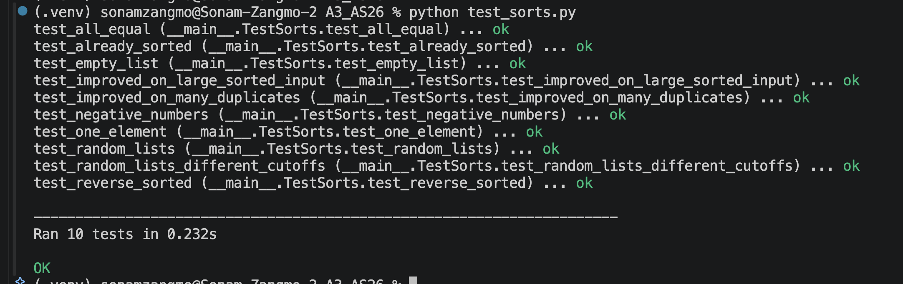
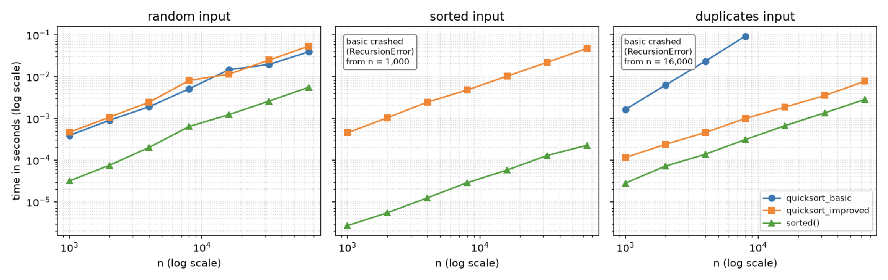
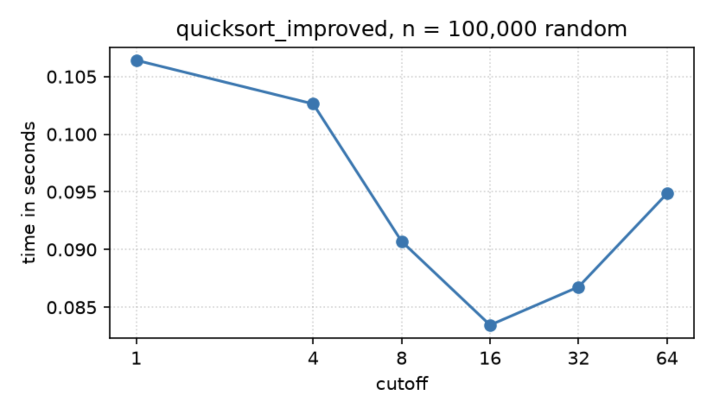
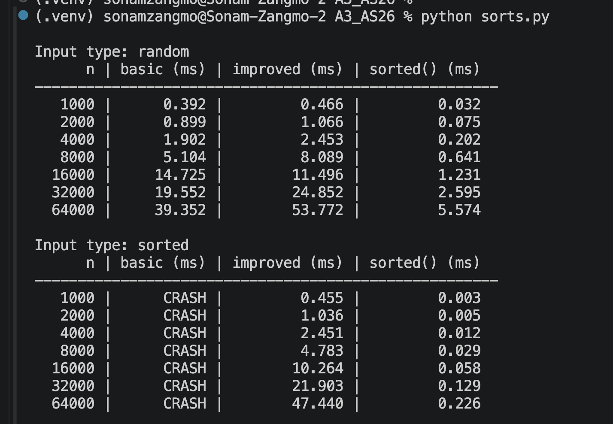
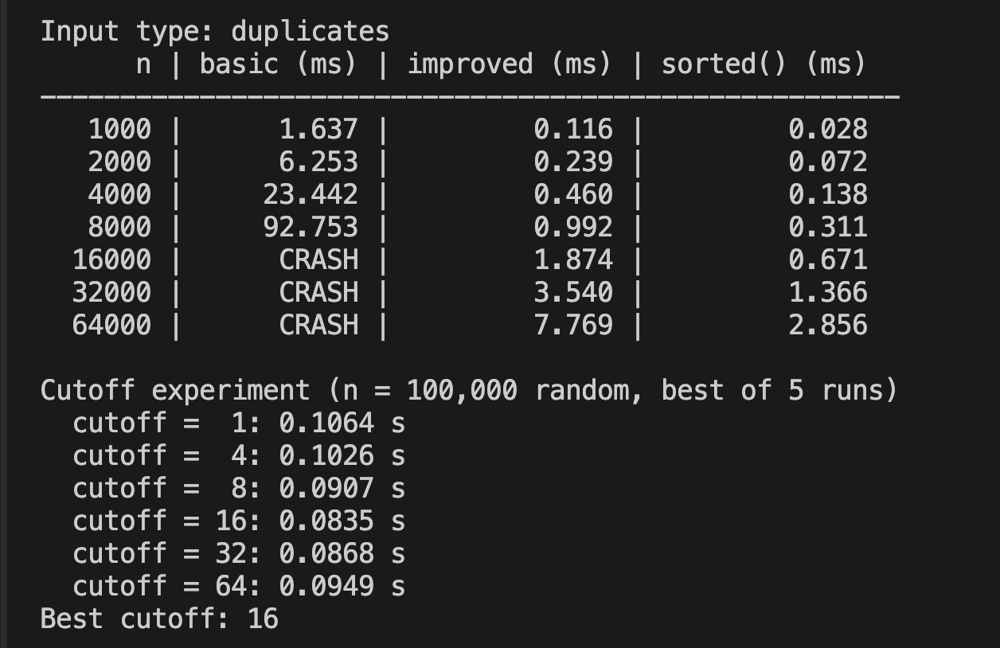
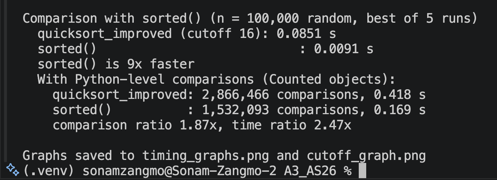

# CSF302 Assignment 3: Fixing a Slow Quicksort

**Sonam Zangmo | Student ID: 02240365 | BE3SWE**

**Full report (PDF):** [CSF302_02240365_A3.pdf](CSF302_02240365_A3.pdf)


**AI tool declaration:** I used Claude (Anthropic) to help structure the code, suggest test cases and improve the wording of this report. I ran every program myself, checked both sorts against sorted() (all tests pass), and all timings below are from my own machine.

## Part A: Implementation (sorts.py)

Both functions sort the list in place and never call sorted() or list.sort().

**quicksort_basic(a):** Lomuto partition with the last element as pivot, then recursion on both sides.

**quicksort_improved(a, cutoff=16):** three fixes from the brief, plus one extra:

- **Random pivot:** the split no longer depends on the input order, so sorted data is not a bad case.

- **Insertion sort** for parts of size ≤ cutoff, which avoids many tiny recursive calls.

- **Recurse on the smaller part, loop on the larger:** each recursive call is at most half the size, so the depth is at most log₂ n (about 17 for 100,000).

- **3-way partition (extra):** splits into \< pivot, = pivot and \> pivot. A random pivot alone does not fix repeated values, because Lomuto puts all values equal to the pivot on one side. With 3-way partitioning, every copy of the pivot value is finished in one pass.

## Part B: Testing (test_sorts.py)

Every test compares the result with sorted(), which is used only in the tests.

| Test        | What it checks                                                                   |
|-----------------|--------------------------------------------------------------------------------------|
| Random lists    | 1,000 random lists of 0–200 values (−1,000 to 1,000), both sorts                     |
| Every cutoff    | 600 more random lists sorted with cutoff = 1, 4, 8, 16, 32 and 64                    |
| Edge cases      | empty list, one element, all equal, already sorted, reverse sorted, negative numbers |
| Real-data cases | 100,000 sorted values (no RecursionError) and 50,000 values that are only 100 or 500 |

*Table 1: Test cases*



*Figure 1: All 10 tests pass*

## Part C: Analysis

### 1. Timing results

Times in milliseconds (best of up to 3 runs). Duplicates means values 0 to 9 only. CRASH means RecursionError.

| n  | Random: basic | Random: improved | Sorted: basic | Sorted: improved | Duplicates: basic | Duplicates: improved |
|--------|-------------------|----------------------|-------------------|----------------------|-----------------------|--------------------------|
| 1,000  | 0.392             | 0.466                | **CRASH**         | 0.455                | 1.637                 | 0.116                    |
| 2,000  | 0.899             | 1.066                | **CRASH**         | 1.036                | 6.253                 | 0.239                    |
| 4,000  | 1.902             | 2.453                | **CRASH**         | 2.451                | 23.442                | 0.460                    |
| 8,000  | 5.104             | 8.089                | **CRASH**         | 4.783                | 92.753                | 0.992                    |
| 16,000 | 14.725            | 11.496               | **CRASH**         | 10.264               | **CRASH**             | 1.874                    |
| 32,000 | 19.552            | 24.852               | **CRASH**         | 21.903               | **CRASH**             | 3.540                    |
| 64,000 | 39.352            | 53.772               | **CRASH**         | 47.440               | **CRASH**             | 7.769                    |

*Table 2: Running time of both sorts on three input types (ms)*



*Figure 2: Log-log graphs of running time for each input type*

quicksort_basic crashed on every sorted input and on duplicates from n = 16,000. Before crashing on duplicates its time grew 3.7× to 4.0× each time n doubled, which is the 4× of a Θ(n²) algorithm. quicksort_improved never crashed and its time roughly doubled each time n doubled on all three inputs (Θ(n log n)). On random data it was usually a little slower than the basic version (1.4× at n = 64,000), which is the cost of the random pivot and the extra comparison in the 3-way partition.

### 2. Why quicksort_basic is slow: T(n) = T(n − 1) + Θ(n)

On sorted input the last element is always the largest, so partitioning does n − 1 comparisons and leaves n − 1 items on one side and none on the other:

$T(n) = T(n - 1) + cn = cn + c(n - 1) + \ldots + c = c\frac{n(n + 1)}{2} = \Theta(n^{2})$

The recursion is also n levels deep. Python stops at 1,000 levels, so every sorted input from n = 1,000 crashed. With duplicates, Lomuto sends values equal to the pivot to the left, so a block of m equal values shrinks by only one item per call: the same recurrence, with m ≈ n/10. The depth n/10 passes 1,000 at n = 16,000, which is exactly where it crashed. The improved version gets T(n) = 2T(n/2) + Θ(n) = Θ(n log n) on average, and its depth stays at most log₂ n.

### 3. Choosing the cutoff

quicksort_improved on n = 100,000 random values, best of 5 runs:

| cutoff | 1  | 4  | 8  | 16 | 32 | 64 |
|------------|--------|--------|--------|--------|--------|--------|
| time (s)   | 0.1064 | 0.1026 | 0.0907 | 0.0835 | 0.0868 | 0.0949 |

*Table 3: Effect of the cutoff*



*Figure 3: Running time against cutoff*

The best cutoff was 16, which is 22% faster than cutoff = 1 (no insertion sort). Very large cutoffs get slower again because insertion sort is Θ(n²), so the parts become too big for it.

### 4. Comparison with Python's sorted()

| n = 100,000 random             | quicksort_improved (cutoff 16) | sorted() |
|------------------------------------|------------------------------------|--------------|
| Time on plain integers             | 0.0851 s                           | 0.0091 s     |
| Number of comparisons              | 2,866,466                          | 1,532,093    |
| Time with Python-level comparisons | 0.418 s                            | 0.169 s      |

*Table 4: My best version compared with sorted()*

sorted() was 9× faster. To separate the algorithm from the language, I wrapped every value in a small class whose comparison is a Python function that also counts calls, so both sorts pay the same price per comparison. My quicksort then did 1.9× as many comparisons and was only 2.5× slower.







*Figure 4: Output of the timing program*

## Part D: Critical Reflection

**1. Why did the basic quicksort fail on sorted data, and which assumption of the average-case analysis did real data break?** The average-case Θ(n log n) analysis assumes every input order is equally likely and the values are distinct, so a pivot taken from a fixed position usually splits the list near the middle. The bank's data breaks both assumptions: it often arrives already sorted, so the last element is always the largest, and it has many repeated amounts, which Lomuto puts all on one side. Each split then removes only one item, giving T(n) = T(n − 1) + Θ(n) = Θ(n²) and n levels of recursion. That is why my basic version crashed on every sorted input and on duplicates from n = 16,000. A random pivot removes the dependence on input order, and the 3-way partition handles the repeats.

**2. Insertion sort is Θ(n²). Why does using it for small parts make quicksort faster?** Big-Θ only describes large n. For a part of 16 items, n² is still tiny, and insertion sort has very low overhead: one simple loop, with no recursive calls, no random numbers and no partitioning. Without a cutoff, quicksort spends much of its time making function calls on parts of 1 to 10 items. In my results the best cutoff (16) was 22% faster than cutoff = 1, while cutoff = 64 was slower again because the n² cost started to matter.

**3. Why is sorted() still faster than your best version? How much of the difference comes from the algorithm and how much from the language?** sorted() was 9× faster. Part of this is the algorithm: Timsort did 1.9× fewer comparisons, and on already sorted input it only needs one pass (0.226 ms against 47.440 ms at n = 64,000). When both sorts were forced to use the same slow Python-level comparison, mine was only 2.5× slower, so roughly 2.5× of the gap comes from the algorithm. The remaining factor of about 3.8× comes from the language: sorted() is written in C, while every step of my quicksort (each comparison, swap and loop) is run by the Python interpreter.

---

## Files and how to run

| File | What it is |
|---|---|
| `sorts.py` | the algorithms (Part A) and the experiments (Part C) |
| `test_sorts.py` | the tests (Part B) |
| `CSF302_02240365_A3.pdf` | the full report as a PDF |
| `screenshots/` | the output screenshots and graphs used above |

Requires Python 3 and matplotlib:

```bash
python3 -m venv .venv
source .venv/bin/activate        # Windows: .venv\Scripts\activate
pip install matplotlib
python test_sorts.py                    # run the tests
python sorts.py                    # run the experiments (under a minute; it prints the tables, cutoff results and sorted() comparison and saves the graphs)
```
