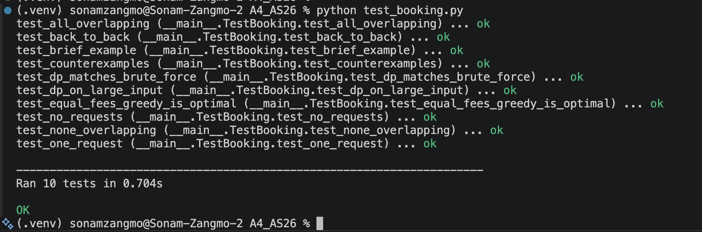
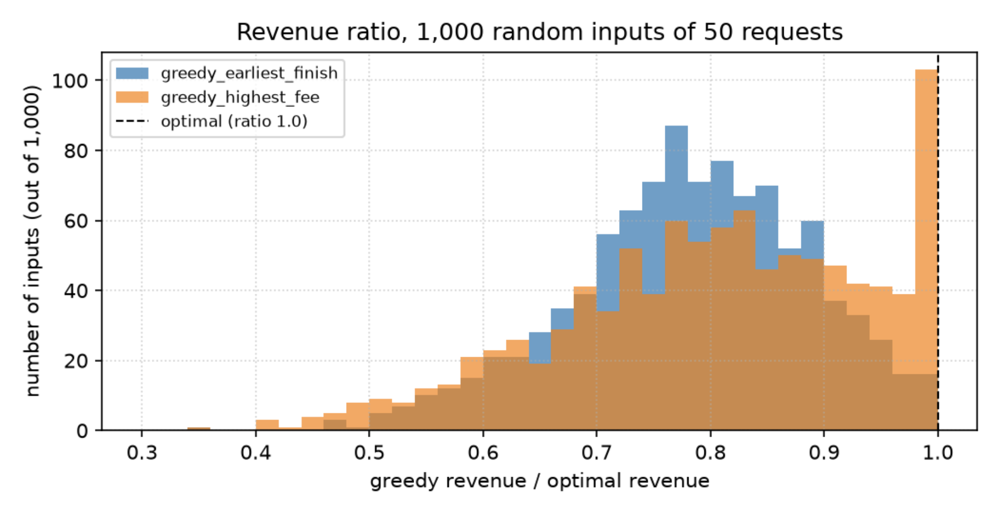
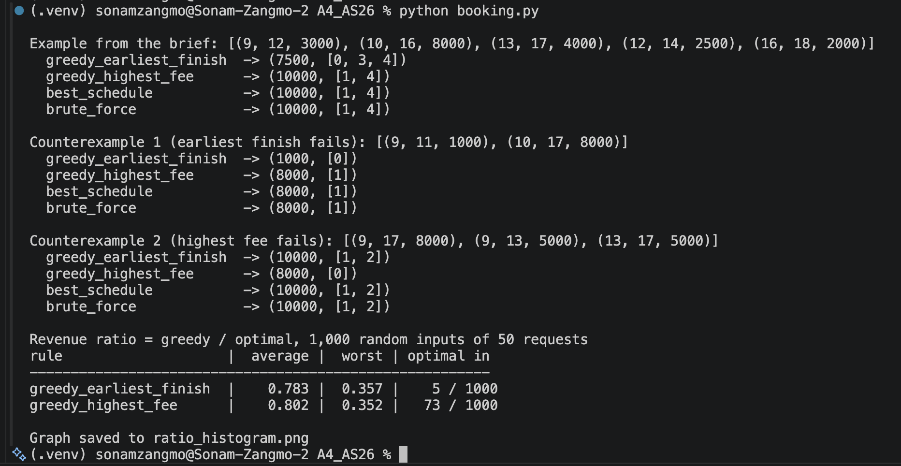

# CSF302 Assignment 4: Booking the Hall

**Sonam Zangmo | Student ID: 02240365 | BE3SWE**

**Full report (PDF):** [CSF302_02240365_A4.pdf](CSF302_02240365_A4.pdf)


**AI tool declaration:** I used Claude (Anthropic) to help structure the code, suggest test cases and improve the wording of this report. I ran every program myself and checked best_schedule against brute_force (all tests pass). All results below are from my own run.

## Part A: Implementation (booking.py)

Each function returns (total_fee, chosen), where chosen is the sorted list of accepted request indices. Two requests fit if one finishes no later than the other starts.

| Function           | How it works                                                                                                                                             |
|------------------------|--------------------------------------------------------------------------------------------------------------------------------------------------------------|
| greedy_earliest_finish | Sort by finish time; accept each request that starts no earlier than the last accepted one finishes.                                                         |
| greedy_highest_fee     | Sort by fee, highest first; accept each request that fits with every request already accepted.                                                               |
| best_schedule (DP)     | Sort by finish time; find p(j) by binary search; fill OPT(j) = max(OPT(j−1), fee_j + OPT(p(j))); walk back through the table to recover the chosen requests. |
| brute_force            | Try all 2ⁿ subsets, keep the valid one with the highest total (for checking only, n ≤ 15).                                                                   |

*Table 1: The four functions*

For the example in the brief, greedy_earliest_finish gives (7500, \[0, 3, 4\]) and best_schedule gives (10000, \[1, 4\]), as expected.

## Part B: Testing (test_booking.py)

Every result is also checked to be a real schedule: no two chosen requests overlap and the total equals their fees.

| Test          | What it checks                                                                                |
|-------------------|---------------------------------------------------------------------------------------------------|
| DP vs brute force | 1,000 random inputs of 0–10 requests: best_schedule always gives the same total as brute_force    |
| Edge cases        | no requests, one request, all overlapping, none overlapping, back-to-back (12–14 after 9–12)      |
| Equal fees        | 1,000 random inputs with all fees equal: greedy_earliest_finish always gives the optimal total    |
| Other checks      | the brief's example, both counterexamples, and 200 inputs of 50 requests (DP ≥ both greedy rules) |

*Table 2: Test cases*



*Figure 1: All 10 tests pass*

## Part C: Analysis

### 1. Counterexamples

| Requests (start, finish, fee)                | Greedy            | Optimal | Greedy earns |
|--------------------------------------------------|-----------------------|-------------|------------------|
| 1\. (9, 11, 1000), (10, 17, 8000)                | Earliest finish: 1000 | 8000        | 12.5%            |
| 2\. (9, 17, 8000), (9, 13, 5000), (13, 17, 5000) | Highest fee: 8000     | 10000       | 80%              |

*Table 3: A counterexample for each greedy rule*

**Earliest finish fails** because it looks only at time, never at money. The cheap 9–11 event finishes first, so it is accepted, and it then blocks the 8000 event.

**Highest fee fails** because it looks only at money, never at how much time an event uses. The 8000 event fills the whole day and blocks two 5000 events that together earn more.

### 2. Why the DP recurrence is correct

$OPT(j) = \max(OPT(j - 1),\ fee_{j} + OPT(p(j)))$, OPT(0) = 0

Sort the requests by finish time and look at the last one, request j. A best schedule of requests 1..j either does not use j, or it does.

- **It does not use j:** then it is a best schedule of requests 1..j−1, worth OPT(j−1).

- **It uses j:** then nothing else may overlap j. Requests 1..p(j) are exactly the ones that finish before j starts, and the rest of the schedule must be a best schedule of these, worth OPT(p(j)). If it were not the best, we could swap in a better one and get more money, which is impossible.

This is optimal substructure: the best answer is built from best answers to smaller problems. Since these are the only two cases, taking the larger one gives the optimum. For the brief's example:

| j | Request (sorted by finish) | p(j) | OPT(j) = max(skip, take)   |
|-------|--------------------------------|----------|--------------------------------|
| 1     | 0: (9, 12, 3000)               | 0        | max(0, 3000 + 0) = 3000        |
| 2     | 3: (12, 14, 2500)              | 1        | max(3000, 2500 + 3000) = 5500  |
| 3     | 1: (10, 16, 8000)              | 0        | max(5500, 8000 + 0) = 8000     |
| 4     | 2: (13, 17, 4000)              | 1        | max(8000, 4000 + 3000) = 8000  |
| 5     | 4: (16, 18, 2000)              | 3        | max(8000, 2000 + 8000) = 10000 |

*Table 4: DP table for the example (walking back takes j = 5, then j = 3: requests 4 and 1)*

### 3. Revenue ratios

1,000 random inputs of 50 requests in one day (start 8:00–19:00, length 1–5 hours, fee Nu 1,000–10,000). Ratio = greedy revenue ÷ optimal revenue from best_schedule.

| Rule               | Average ratio | Worst ratio | Optimal in |
|------------------------|-------------------|-----------------|----------------|
| greedy_earliest_finish | 0.783             | 0.357           | 5 of 1,000     |
| greedy_highest_fee     | 0.802             | 0.352           | 73 of 1,000    |

*Table 5: Greedy revenue compared with the optimum*



*Figure 2: Spread of the revenue ratio for each rule*

### 4. Time complexity

| Function           | Time   | Reason                                                          |
|------------------------|------------|---------------------------------------------------------------------|
| greedy_earliest_finish | O(n log n) | sorting; then one pass of O(1) checks                               |
| greedy_highest_fee     | O(n²)      | sorting, then each request is checked against up to n accepted ones |
| best_schedule          | O(n log n) | sorting, n binary searches for p(j), O(n) table and walk back       |
| brute_force            | O(2ⁿ · n²) | 2ⁿ subsets, each checked pair by pair                               |

*Table 6: Time complexity of each function*



*Figure 3: Output of the analysis program*

## Part D: Critical Reflection

**1. Your greedy rules passed some tests before you found a counterexample. What does this say about using testing to prove correctness?** Highest fee gave the optimal answer on the brief's example and on 73 of my 1,000 random days, and earliest finish was optimal on every equal-fee test. Yet a two-request input is enough to show earliest finish is wrong. Passing tests only shows a rule works on those inputs; one counterexample proves it is not correct in general. Testing can find bugs but cannot prove their absence. That is why I checked best_schedule against brute_force on 1,000 inputs and also explained why the recurrence is correct (C.2): the tests give confidence, but the argument covers every input.

**2. Should the manager keep the simple rule? Use your revenue ratios from Part C.** No, if the goal is money. Earliest finish earned on average only 78.3% of the best possible revenue, was optimal on just 5 of 1,000 days, and on its worst day earned 35.7%. That is about a fifth of the income lost on a typical day. best_schedule is also O(n log n), so it is just as fast for a hall with 50 requests. Earliest finish is still the right rule if the manager wants to host the most events, since it maximises the number of bookings.

**3. Why does greedy work when all fees are equal but fail when fees differ?** With equal fees, the most money simply means the most events. Take any best schedule and replace its first event with the request that finishes earliest. That request ends no later, so everything after it still fits, and the number of events stays the same. Repeating this turns any best schedule into the greedy one without losing anything. When fees differ, the same swap can replace an expensive event with a cheap one: the count stays the same but the money drops, as in counterexample 1 (1000 instead of 8000).

---

## Files and how to run

| File | What it is |
|---|---|
| `booking.py` | the algorithms (Part A) and the experiments (Part C) |
| `test_booking.py` | the tests (Part B) |
| `CSF302_02240365_A4.pdf` | the full report as a PDF |
| `screenshots/` | the output screenshots and graphs used above |

Requires Python 3 and matplotlib:

```bash
python3 -m venv .venv
source .venv/bin/activate        # Windows: .venv\Scripts\activate
pip install matplotlib
python test_booking.py                    # run the tests
python booking.py                    # run the experiments (about 10 seconds; it prints the example, counterexamples and ratio table and saves the histogram)
```
