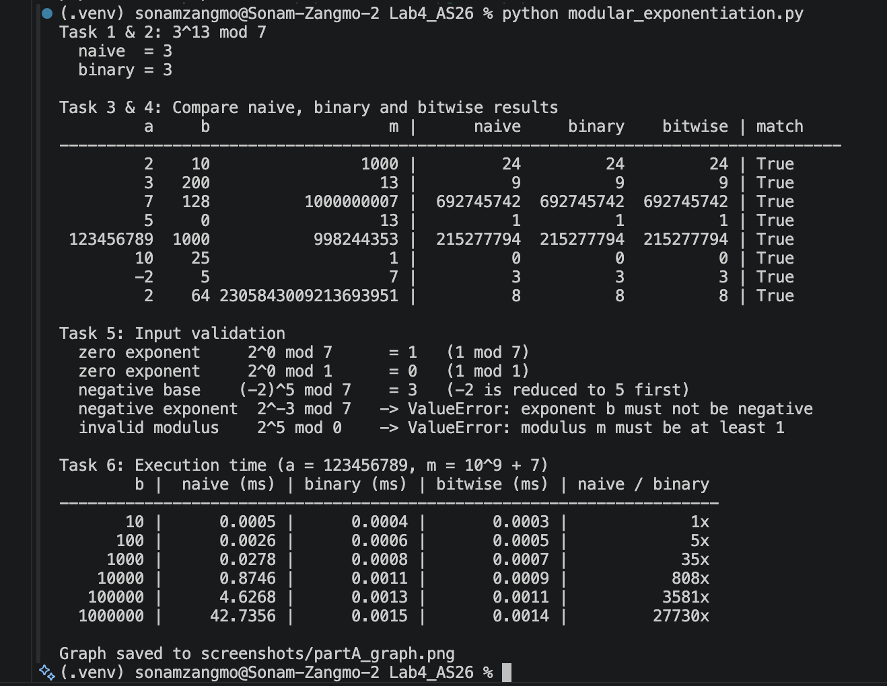
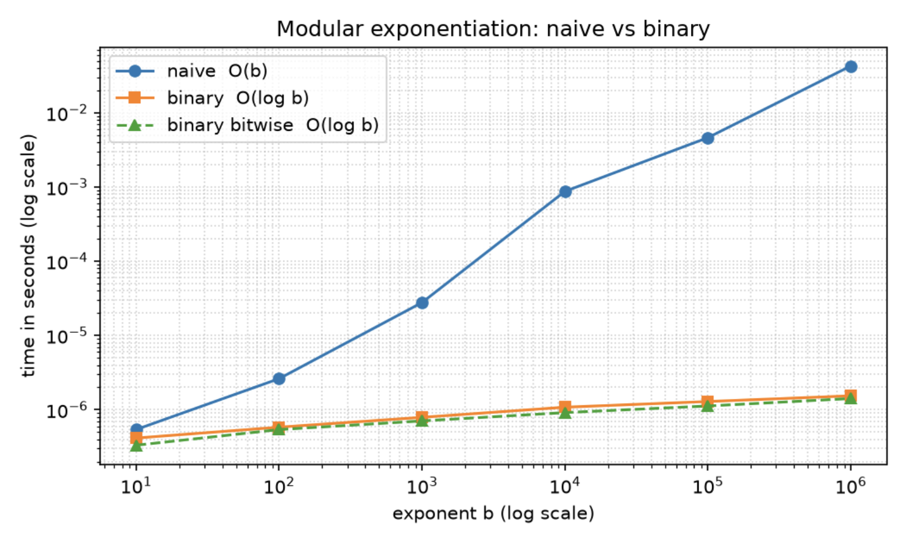
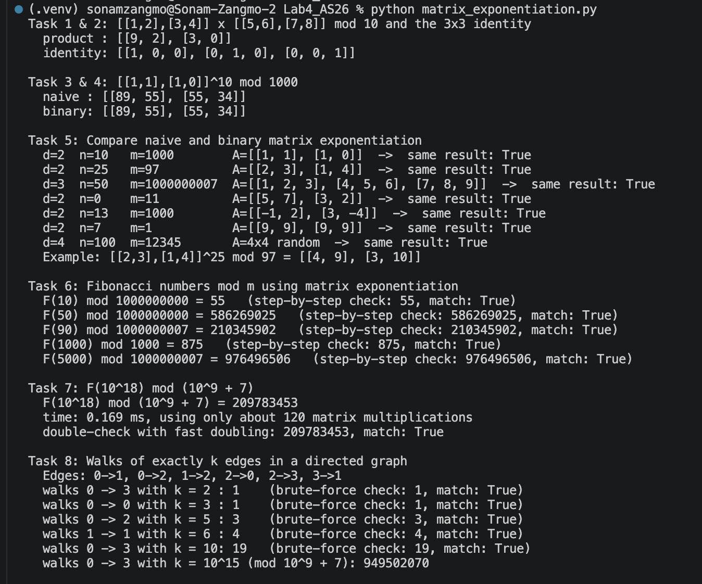
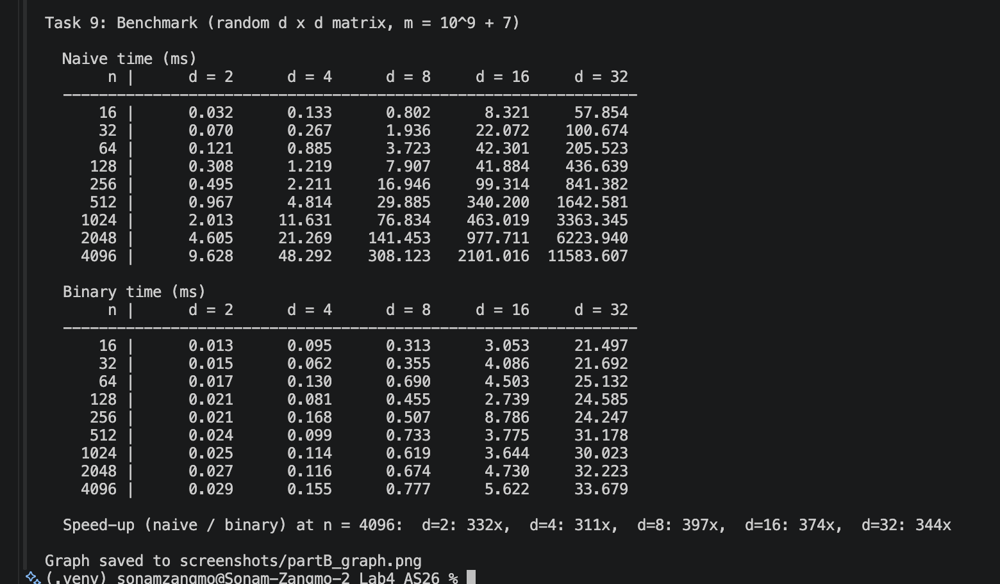
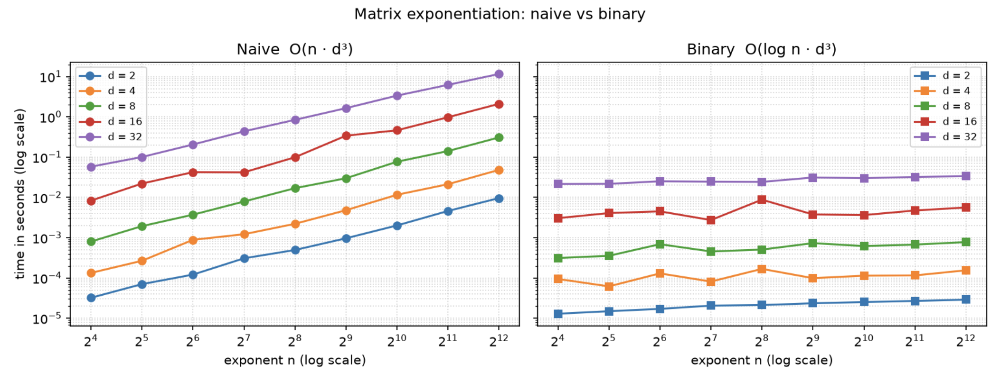

# CSF302 : Algorithm Design & Analysis
## Lab Report 4: Modular and Matrix Exponentiation

## Part A: Efficient Modular Exponentiation

**Code:** `modular_exponentiation.py`

Calculates aᵇ mod m in three ways and compares them:

| Method | Idea | Time |
|---|---|---|
| Naive | multiply by a, b times | O(b) |
| Binary | square-and-multiply (`b % 2`, `b // 2`) | O(log b) |
| Binary bitwise | same, using `b & 1` and `b >>= 1` | O(log b) |

**Input validation:**
- Zero exponent returns 1 mod m.
- Negative base is reduced to a mod m first.
- Negative exponent raises an error.
- Modulus m < 1 raises an error.

**Output:**

*Figure 1: Part A output. All three methods give the same answers as Python's `pow` (Tasks 1–4), the validation cases behave as required (Task 5), and the timing table covers b = 10 to 10⁶ (Task 6).*

**Graph:**

*Figure 2: Execution time against exponent b (log-log scale). The naive time grows roughly in step with b (the bump at b = 10⁴ is timing noise), while both binary versions stay almost flat.*

**Reflection:**
All three methods gave the same answers, but binary exponentiation was about 27,700 times faster at b = 10⁶ (42.7 ms against 0.0015 ms), because it needs only about log₂ b ≈ 20 squarings instead of a million multiplications. The bitwise version was only slightly faster than the normal binary one, since both do the same number of steps.

---

## Part B: Efficient Matrix Modular Exponentiation

**Code:** `matrix_exponentiation.py`

| Function | What it does | Time |
|---|---|---|
| `mat_mult` | multiplies two d × d matrices mod m | O(d³) |
| `identity` | builds the d × d identity matrix | O(d²) |
| `naive_mat_pow` | Aⁿ mod m by n multiplications | O(n · d³) |
| `binary_mat_pow` | Aⁿ mod m by repeated squaring | O(log n · d³) |
| `fib_mod` | F(n) mod m from [[1,1],[1,0]]ⁿ | O(log n) |
| `count_walks` | walks of exactly k edges, from entry (u, v) of Aᵏ | O(log k · d³) |

Every result is checked against a slow step-by-step method.

**Output:**

*Figure 3: Part B output, Tasks 1–8. Naive and binary give the same matrices, and the Fibonacci numbers and walk counts match the step-by-step checks. **F(10¹⁸) mod (10⁹ + 7) = 209783453**, found without generating the earlier Fibonacci numbers.*

*Figure 4: Part B benchmark (Task 9). Time in ms for d = 2, 4, 8, 16, 32 and n = 2⁴ to 2¹². At n = 4096, binary is 311× to 397× faster.*

**Graph:**

*Figure 5: Execution time against exponent n for each matrix size d (log-log scale). Naive (left) roughly doubles every time n doubles; binary (right) stays almost flat (the small bumps are timing noise).*

**Reflection:**
Naive matrix exponentiation grew linearly with n, but binary grew only with log n, so at n = 4096 it was 311 to 397 times faster for every matrix size. Doubling d made both methods about 5 to 7 times slower. This is a little less than the 8× that d³ predicts, because for small matrices Python's fixed overhead is a large share of the time. Matrix exponentiation turned problems that look impossible into fast ones: F(10¹⁸) took only 0.169 ms, and counting walks of length k is just one entry of Aᵏ.
