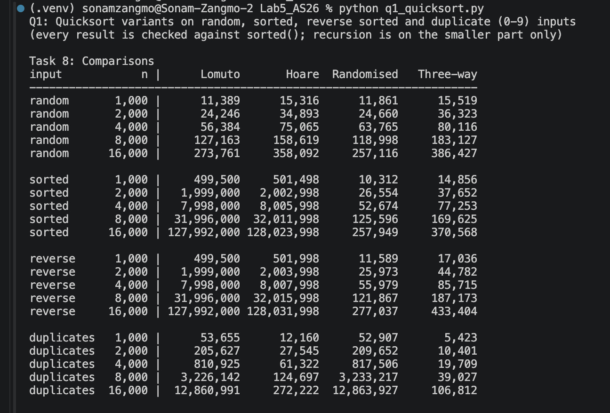
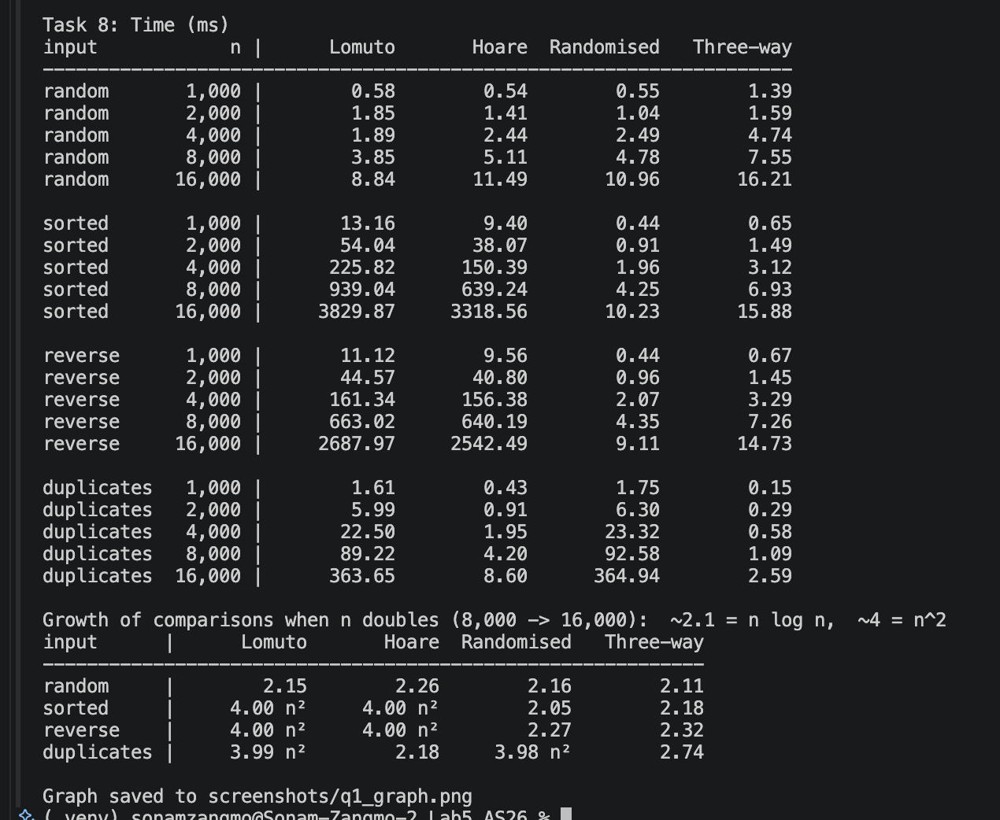
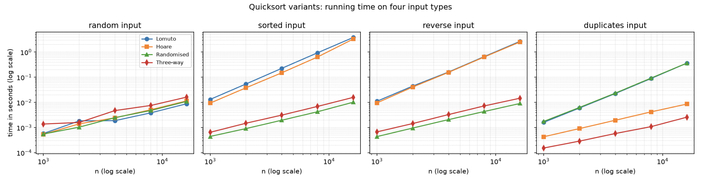
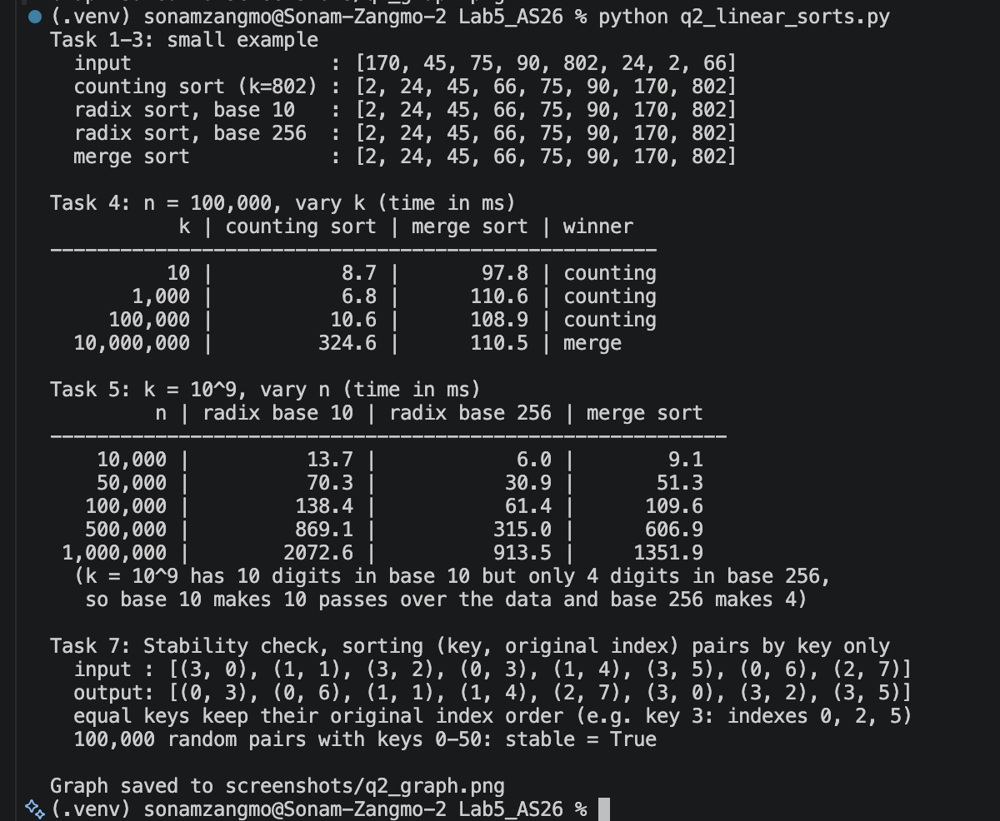
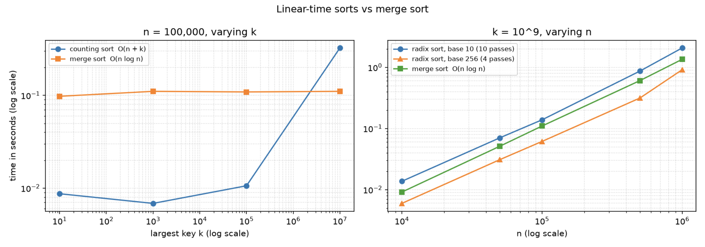
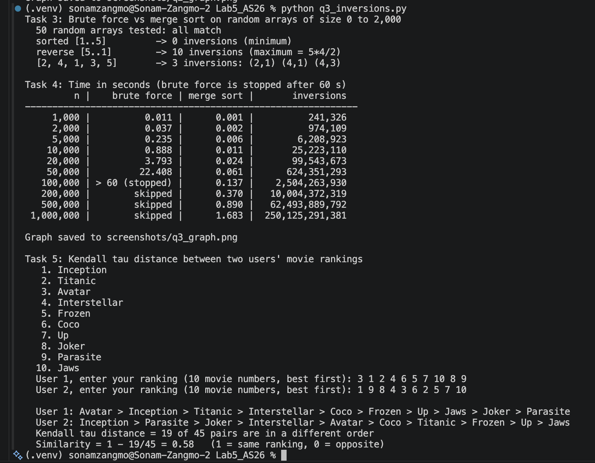
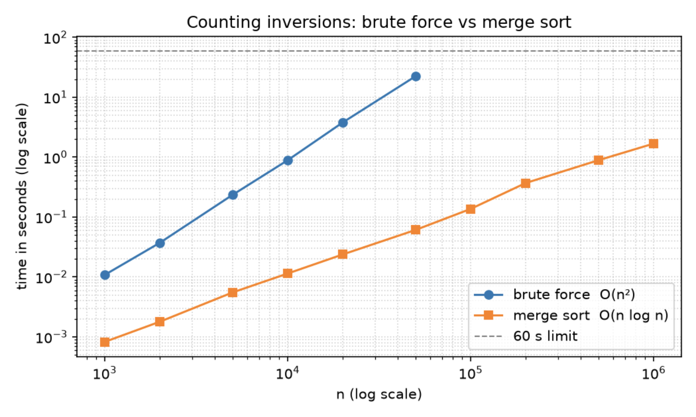

# CSF302 : Algorithm Design & Analysis
## Lab Report 5: Sorting Algorithms

## Q1: Quicksort Variants

**Code:** `q1_quicksort.py`

Four in-place quicksorts are compared by counting element comparisons and measuring time for n = 1,000 to 16,000 on four input types: random, already sorted, reverse sorted, and many duplicates (values 0 to 9).

| Variant | Partition | Pivot |
|---|---|---|
| Lomuto | Lomuto | last element |
| Hoare | Hoare | first element |
| Randomised | Lomuto | random element |
| Three-way | Dutch national flag (< , = , >) | random element |

Every variant recurses on the **smaller** part and loops on the larger one. This keeps the recursion depth at most log₂ n, so even the Θ(n²) cases on sorted input never hit Python's recursion limit. Every result is checked against `sorted()`.

**Output:**

*Figure 1: Number of comparisons for each variant, input type and size.*

*Figure 2: Running time in ms, and how much the comparisons grow when n doubles from 8,000 to 16,000. About 2.1 means Θ(n log n); 4.00 (marked n²) means Θ(n²).*

**Graph:**

*Figure 3: Running time against n for each input type (log-log scale). A steeper line means faster growth; the Θ(n²) cases have twice the slope of the others.*

**Which variant degrades to Θ(n²), and why:**

| Input | Degrades to Θ(n²) | Why |
|---|---|---|
| Random | none | any fixed pivot position is a random value, so splits are roughly even |
| Sorted | Lomuto, Hoare | the last element is the largest and the first is the smallest, so every split is n − 1 and 0 |
| Reverse sorted | Lomuto, Hoare | the same problem with the extreme values swapped |
| Duplicates (0–9) | Lomuto, Randomised | Lomuto sends every value equal to the pivot to the same side, so a block of equal values shrinks by only one per call |

In every Θ(n²) case the recurrence is T(n) = T(n − 1) + Θ(n), and the comparisons grew by exactly 4.00 times each time n doubled. At n = 16,000, Lomuto made about 128 million comparisons on sorted input against about 258 thousand for the randomised version, and took 3.8 s against 0.01 s. Hoare survives duplicates because it stops and swaps on values equal to the pivot, which splits equal blocks evenly. Three-way never degrades: the random pivot handles sorted and reverse input, and each block of equal values is finished in one pass. On duplicates it made only about 107 thousand comparisons at n = 16,000, against 12.9 million for Lomuto.

**Reflection:**
I expected the pivot choice to matter, but I did not expect Lomuto with a random pivot to fail as badly as the fixed pivot on duplicates. A random pivot only protects against bad *order*, not against *repeated values*, so only the three-way version was safe on all four inputs. On random data, three-way was the slowest because it makes up to two comparisons per element, so the safest variant is not always the fastest.

---

## Q2: Counting Sort and Radix Sort

**Code:** `q2_linear_sorts.py`

| Function | Method | Time |
|---|---|---|
| `counting_sort(a, k)` | count each key, prefix sums, place items left to right (stable) | O(n + k) |
| `radix_sort(a, base)` | LSD: stable counting sort on each digit, base 10 or base 256 | O(d · (n + base)) |
| `merge_sort(a)` | merge sort, same method as Lab 1 | O(n log n) |

Counting sort is timed with n = 100,000 and k = 10, 10³, 10⁵, 10⁷. Radix sort and merge sort are timed with k = 10⁹ and n = 10,000 to 1,000,000. Stability is shown by sorting (key, original index) pairs.

**Output:**

*Figure 4: Q2 output. The small example is sorted by all four methods, followed by the tables for varying k and varying n. The stability check shows equal keys keep their original order.*

**Graph:**

*Figure 5: Left: counting sort against merge sort as k grows (n = 100,000). Right: radix sort (base 10 and base 256) against merge sort as n grows (k = 10⁹).*

**When the linear-time sorts win and when they lose:**
- **Counting sort wins when k is small compared with n.** Up to k = 10⁵ it was about 10 to 16 times faster than merge sort, because it never compares items.
- **Counting sort loses when k is much bigger than n.** At k = 10⁷ it has to build and scan a count array 100 times longer than the data, so it was about 3 times slower than merge sort (325 ms against 111 ms). O(n + k) is only "linear" when k = O(n).
- **Radix sort wins when there are few digits.** With k = 10⁹, base 256 needs only 4 passes and was 1.5 to 1.9 times faster than merge sort for every n.
- **Radix sort can lose when there are many digits.** Base 10 needs 10 passes, and each pass touches every item twice, so it was 1.3 to 1.5 times slower than merge sort at every n. Its O(d · n) is linear, but with d = 10 the constant factor is bigger than log₂ n for these sizes, so the number of passes decides the winner.

**Reflection:**
I learned that "linear time" hides a second variable: k for counting sort and the number of digits for radix sort. Choosing base 256 instead of base 10 changed radix sort from losing to winning without changing the algorithm, just by cutting the number of passes from 10 to 4. Stability is what makes radix sort work, because each pass must keep the order created by the earlier digits.

---

## Q3: Counting Inversions

**Code:** `q3_inversions.py`

An inversion is a pair i < j with a[i] > a[j].
- **Brute force:** checks every pair, O(n²).
- **Merge-sort method:** during each merge, when an item from the right half is placed first, it forms an inversion with every item left in the left half. This gives O(n log n).

Both methods are checked on 50 random arrays of size 0 to 2,000 (with repeated values), then timed for n = 1,000 to 1,000,000. Brute force stops itself once it passes 60 seconds. Finally, the Kendall tau distance between two users' rankings of 10 movies, typed from the keyboard, is the number of movie pairs they order differently. It equals the number of inversions when user 2's positions are listed in user 1's order.

**Output:**

*Figure 6: Q3 output. Both methods give the same count on all 50 test arrays (Task 3). Brute force stops at the 60 s limit at n = 100,000, while merge sort reaches n = 1,000,000 in 1.7 s (Task 4). The two rankings typed from the keyboard have a Kendall tau distance of 19 of 45 pairs, a similarity of 0.58 (Task 5).*

**Graph:**

*Figure 7: Time to count inversions (log-log scale). Brute force stops before the 60 s line; merge sort grows almost linearly up to 1,000,000.*

**Reflection:**
Brute force grew about 4 times each time n doubled and could not finish n = 100,000 within a minute, while the merge-sort method counted 250 billion inversions in 1,000,000 numbers in 1.7 seconds. The key idea is counting a whole group of inversions at once during the merge instead of one pair at a time. The Kendall tau task showed a real use: comparing two people's rankings is just counting inversions.
