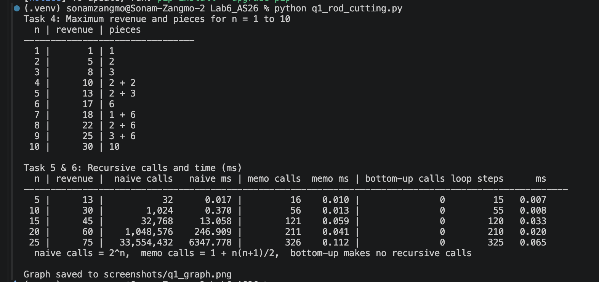
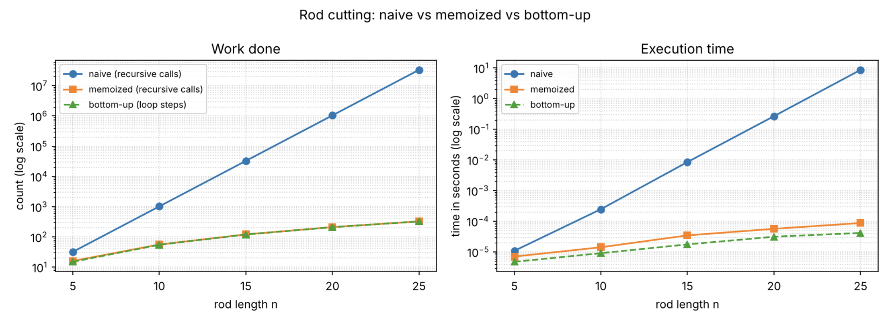
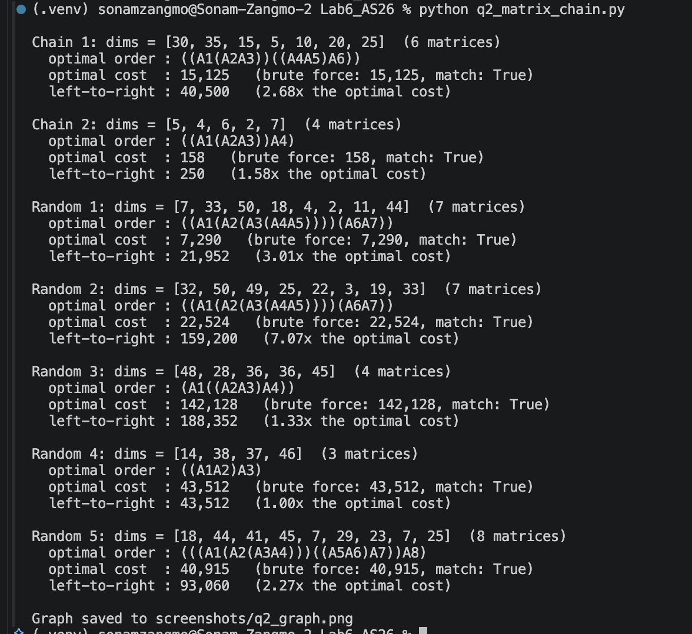
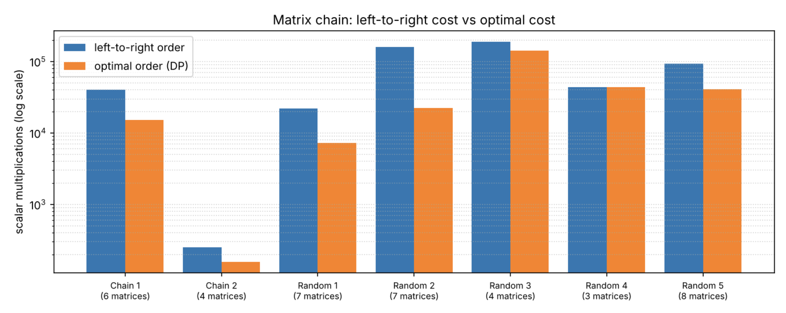
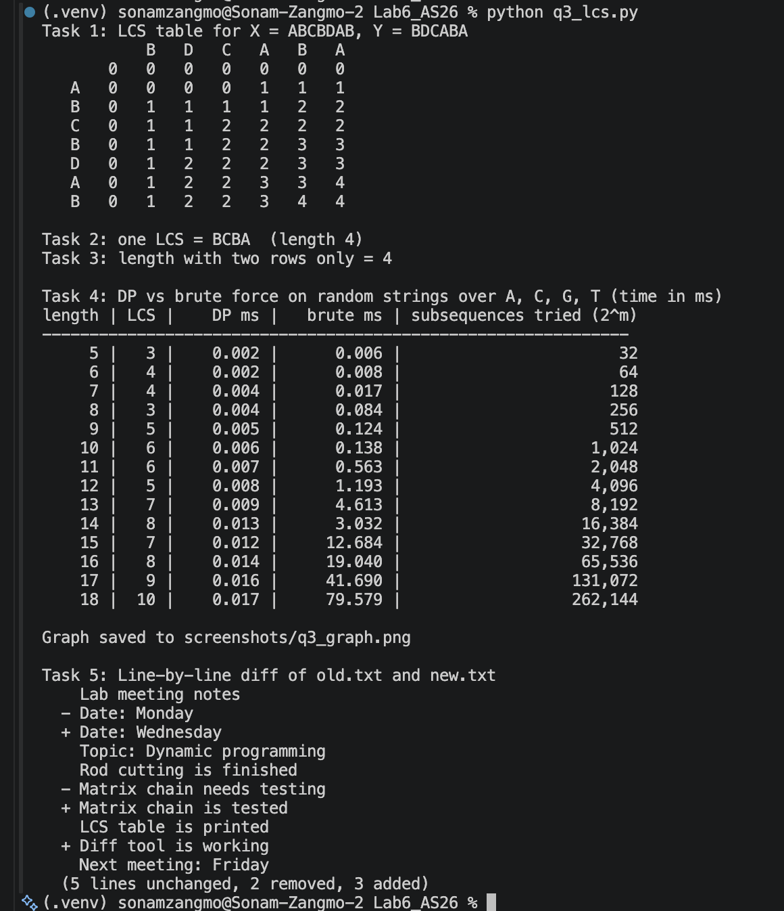
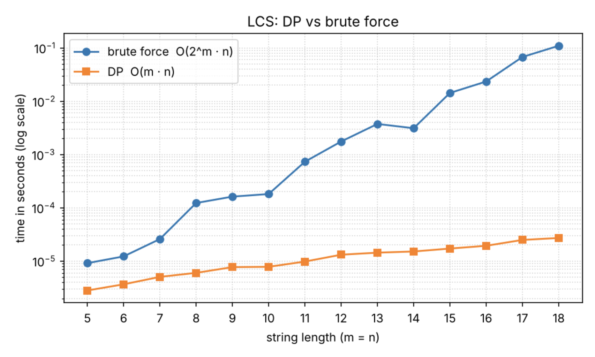
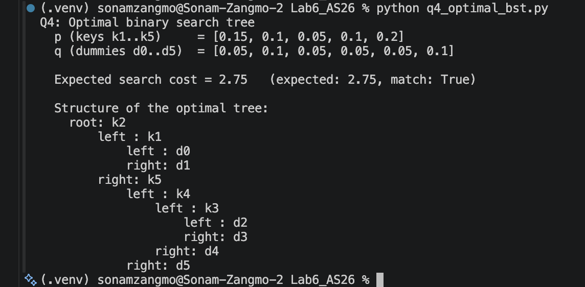

# CSF302 : Algorithm Design & Analysis
## Lab Report 6: Dynamic Programming

## Q1: Rod Cutting

**Code:** `q1_rod_cutting.py`

The price table for lengths 1 to 10 is 1, 5, 8, 9, 10, 17, 17, 20, 24, 30, and p[i] = 3i for i > 10. The best revenue follows the recurrence r(n) = max over the first piece i of (p[i] + r(n − i)), with r(0) = 0. It is solved in three ways:

| Version | Idea | Time |
|---|---|---|
| Naive recursive | tries every first cut, solving the same sub-rods again and again | O(2ⁿ) |
| Top-down memoized | same recursion, but saves each r(j) the first time it is found | O(n²) |
| Bottom-up tabulated | fills r(1), r(2), ..., r(n) in a loop, no recursion | O(n²) |

**Output:**

*Figure 1: Maximum revenue and the pieces for n = 1 to 10 (Task 4), then the recursive calls and time of each version for n = 5 to 25 (Tasks 5 and 6). All three versions give the same revenue.*

**Graph:**

*Figure 2: Work done and execution time against rod length (log scale). The naive line is straight on a log scale, which means exponential growth; the two DP versions grow slowly.*

**Why the counts are so different:**
The naive version makes exactly 2ⁿ calls (33,554,432 for n = 25) because it never remembers anything: r(n − 1), r(n − 2), ... are solved again inside every branch. These are *overlapping subproblems*. The memoized version solves each of the n + 1 sub-rods only once, so it makes only 1 + n(n + 1)/2 calls (326 for n = 25). The bottom-up version does the same n(n + 1)/2 steps in a loop with no recursive calls at all, which makes it the fastest. At n = 25, naive took 6.3 seconds, while memoized took 0.11 ms and bottom-up 0.07 ms, about 50,000 times faster.

**Reflection:**
The three versions use the same recurrence and give the same answers, so the only difference is whether solved subproblems are reused. Adding one dictionary changed the work from 33 million calls to 326. Bottom-up was a little faster than memoized because it avoids the cost of function calls and dictionary lookups.

---

## Q2: Matrix Chain Multiplication

**Code:** `q2_matrix_chain.py`

Matrix Aᵢ has size dims[i−1] × dims[i]. The bottom-up DP fills
m[i][j] = min over k of (m[i][k] + m[k+1][j] + dims[i−1] · dims[k] · dims[j])
for chains of length 2, 3, ..., n. It records the best split k, which is then used to print the parenthesisation. The answer is checked with a brute-force recursive search that tries every split with no table.

**Output:**

*Figure 3: Optimal order, optimal cost and left-to-right cost for the two given chains and 5 random chains. Every DP answer matches brute force, and <30, 35, 15, 5, 10, 20, 25> gives the expected 15,125 with order ((A1(A2A3))((A4A5)A6)).*

**Graph:**

*Figure 4: Cost of the left-to-right order compared with the optimal order for each chain (log scale).*

**Reflection:**
The order of multiplication never changes the result, but it changed the cost by up to 7 times in my chains. Left-to-right was optimal only once (a chain of 3 matrices). A good order multiplies small matrices together first, so the running result stays small. Brute force agreed with the DP on every chain, but it tries every split at every level, so its work grows exponentially. The DP solves each of the O(n²) sub-chains once, in O(n³) time.

---

## Q3: Longest Common Subsequence

**Code:** `q3_lcs.py` (uses `old.txt` and `new.txt`)

| Function | What it does | Time / space |
|---|---|---|
| `lcs_table` | fills c[i][j] = LCS length of X[:i] and Y[:j], bottom-up | O(mn) / O(mn) |
| `lcs_reconstruct` | walks back from c[m][n]: a match on the diagonal is part of the LCS | O(m + n) |
| `lcs_length_two_rows` | keeps only the previous and current row | O(mn) / O(n) |
| `lcs_brute` | tries all 2ᵐ subsequences of X, keeps the longest also in Y | O(2ᵐ · n) |
| `diff` | LCS of the two files' lines; lines in the LCS are unchanged | O(mn) |

**Output:**

*Figure 5: Q3 output. The LCS table for X = ABCBDAB and Y = BDCABA (Task 1); one LCS is BCBA, of length 4 (Task 2), and the two-row version gives the same length (Task 3). DP against brute force for lengths 5 to 18, with brute force trying all 2ᵐ subsequences (Task 4). Finally a line-by-line diff of `old.txt` and `new.txt`: unchanged lines have no mark, removed lines start with −, and added lines start with + (Task 5).*

**Graph:**

*Figure 6: Running time against string length (log scale). Brute force about doubles with every extra character, while the DP stays below 0.02 ms.*

**Reflection:**
Brute force had to check 262,144 subsequences for strings of length 18 (79.6 ms), while the DP filled only 18 × 18 = 324 cells (0.017 ms), and both found the same length every time. The two-row version showed that the table is only needed to *rebuild* the LCS; the length alone needs O(n) memory. The diff task showed that LCS is a practical tool: it is the same idea behind `git diff`.

---

## Q4 (Optional): Optimal Binary Search Tree

**Code:** `q4_optimal_bst.py`

The keys k1 to k5 have p = 0.15, 0.10, 0.05, 0.10, 0.20, and the dummy keys d0 to d5 have q = 0.05, 0.10, 0.05, 0.05, 0.05, 0.10. The DP tries every key as the root of every range of keys:

e[i][j] = min over root r of (e[i][r−1] + e[r+1][j] + w(i, j))

Here w(i, j) is the total probability of the range, because every node in the subtree moves one level deeper under the new root.

**Output:**

*Figure 7: The expected search cost is 2.75, matching the expected value, followed by the structure of the optimal tree. k2 is the root, with k1 on the left and k5 on the right; k5 has k4 as its left child, and k4 has k3 as its left child.*

**Reflection:**
The optimal tree is not the balanced one: k5, the most likely key (0.20), sits near the top, while k3, the least likely (0.05), sits at the bottom. Like matrix chain multiplication, the best answer for a range is built from the best answers for the smaller ranges on each side of the chosen root.
