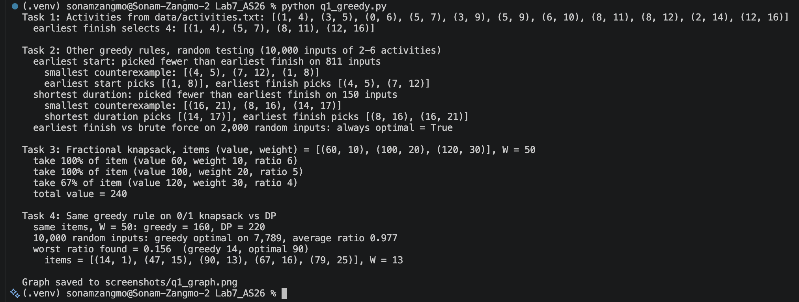
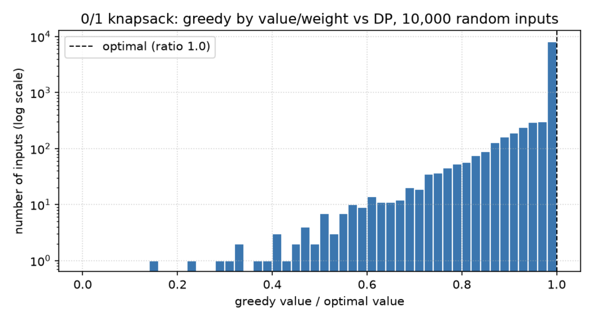
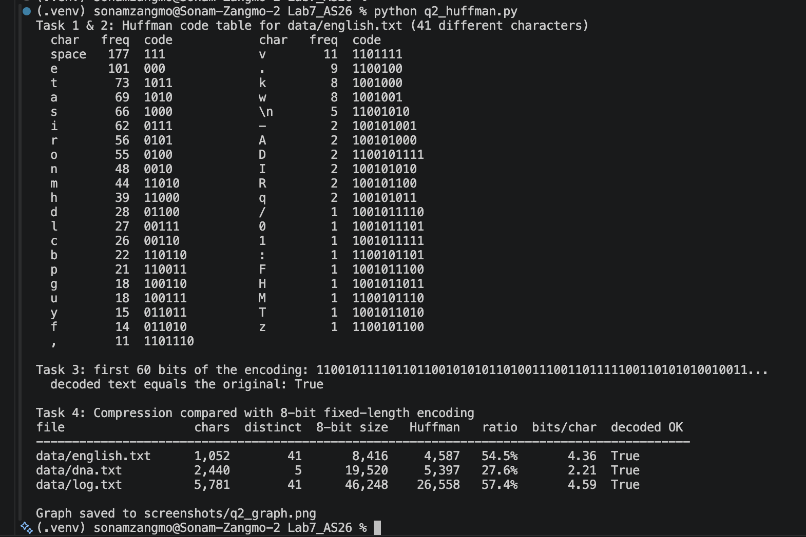
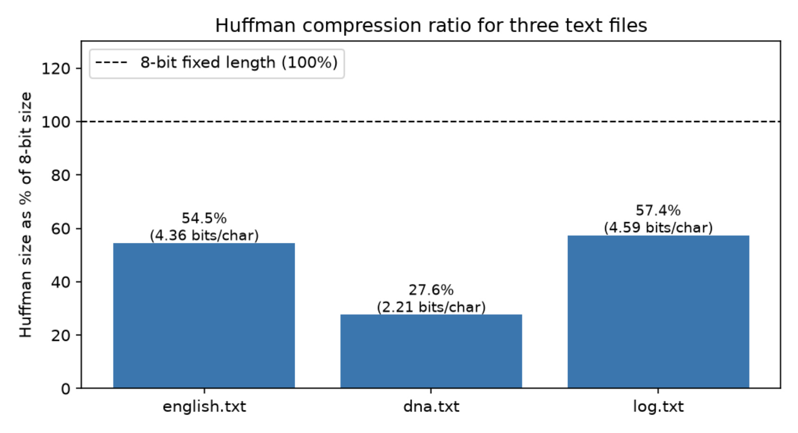
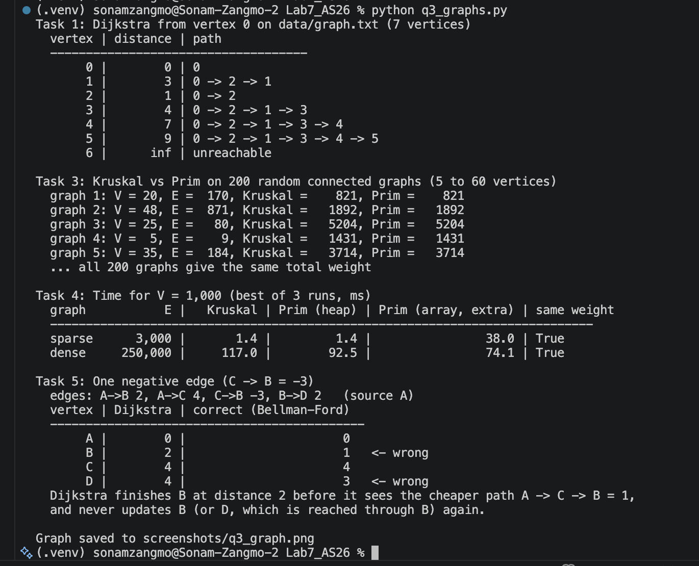
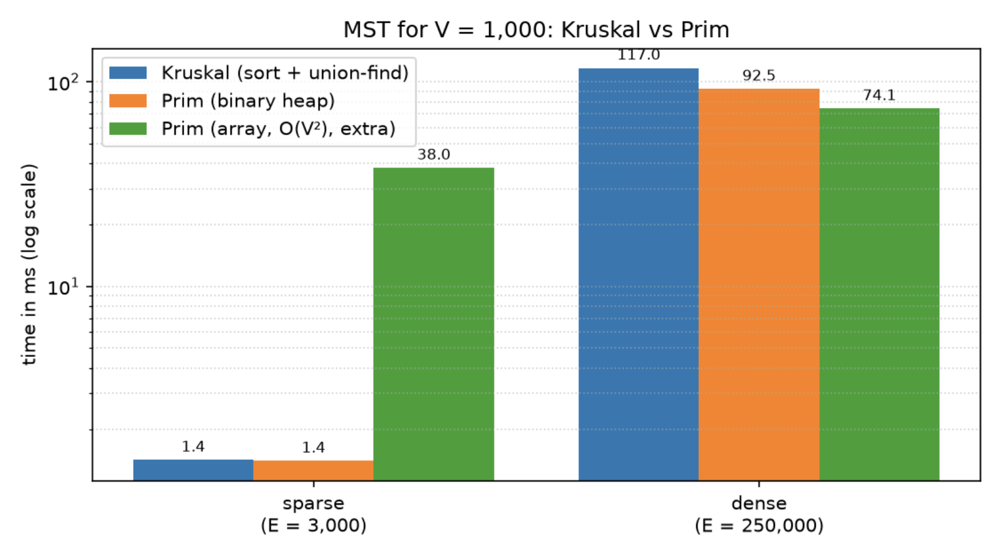
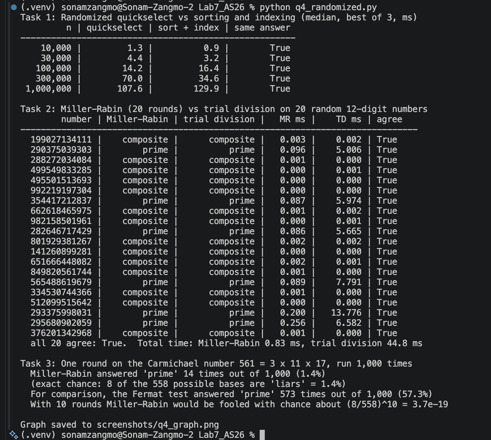
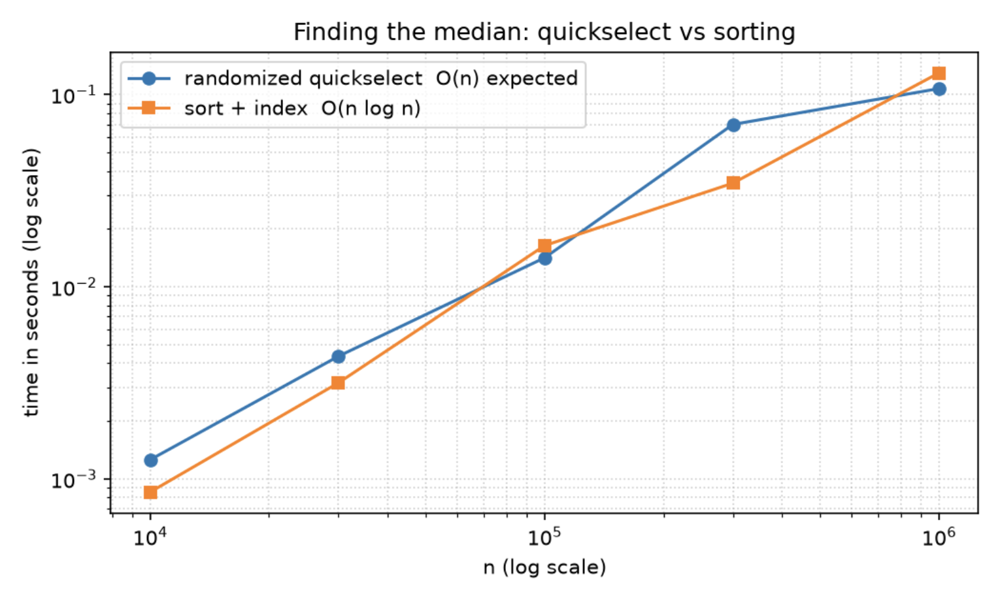

# CSF302 : Algorithm Design & Analysis
## Lab Report 7: Greedy and Randomized Algorithms

Input files are in `data/`: `activities.txt` (Q1), `english.txt`, `dna.txt` and `log.txt` (Q2), and `graph.txt` (Q3).

## Q1: Activity Selection and Knapsack

**Code:** `q1_greedy.py`

| Function | Greedy rule | Optimal? |
|---|---|---|
| `select_earliest_finish` | pick the activity that finishes first, skip any that overlap | yes |
| `select_earliest_start` | pick the activity that starts first | no |
| `select_shortest` | pick the shortest activity | no |
| `fractional_knapsack` | highest value/weight first, take a fraction of the last item | yes |
| `greedy_01_knapsack` | the same rule, but items cannot be split | no |
| `dp_01_knapsack` | dynamic programming, best[c] for every capacity c | yes |

The activities are read as (start, finish) pairs from `data/activities.txt`. Random testing, 10,000 inputs per rule, finds counterexamples for the other two activity rules. Earliest finish is checked against brute force on 2,000 random inputs. Greedy 0/1 knapsack is compared with the DP on 10,000 random inputs.

**Output:**

*Figure 1: Q1 output. Earliest finish selects 4 activities (Task 1). Random testing finds a counterexample for each of the other two rules (Task 2). Fractional knapsack takes 2/3 of the last item for a value of 240 (Task 3). Greedy against DP on 0/1 knapsack gives the worst ratio found (Task 4).*

**Graph:**

*Figure 2: The ratio of greedy value to optimal value for 0/1 knapsack over 10,000 random inputs (log scale). Most inputs are at 1.0, but there is a long tail of bad results.*

**Results:**
- **Earliest start fails** when an early, long activity blocks two short ones. In the counterexample, (1, 8) is chosen first and blocks both (4, 5) and (7, 12).
- **Shortest duration fails** when a short activity overlaps two longer ones that fit together. In the counterexample, (14, 17) blocks both (8, 16) and (16, 21).
- **Earliest finish was never beaten**: it matched brute force on all 2,000 inputs. Finishing first leaves the most time for everything else.
- **0/1 knapsack:** greedy was optimal on about 78% of inputs, but the **worst ratio was 0.156**. A small item with the best ratio (value 14, weight 1) was taken first, and then the item worth 90 no longer fit.

**Reflection:**
The same greedy rule, highest value per kilogram, is optimal for fractional knapsack but can be very wrong for 0/1 knapsack. Being able to take part of an item is exactly what makes the greedy choice safe. Random testing found counterexamples within seconds, but it can only show that a rule is wrong; showing that earliest finish is *right* needs the exchange argument.

---

## Q2: Huffman Coding

**Code:** `q2_huffman.py`

The program counts how often each character appears, puts every character in a `heapq` priority queue, and repeatedly merges the two least frequent nodes until one tree is left. Going left adds a 0 to the code and going right adds a 1. Each text file is encoded to a bit string, decoded back, and checked against the original. It is compared with 8-bit fixed-length encoding for three different files:
- `english.txt`: ordinary English text
- `dna.txt`: only 4 letters and line breaks
- `log.txt`: a repetitive server log

**Output:**

*Figure 3: The Huffman code table for `english.txt`, from most to least frequent (Tasks 1 and 2). The first bits of the encoding and the decoding check (Task 3), then the compression table for the three files (Task 4).*

**Graph:**

*Figure 4: Huffman size as a percentage of the 8-bit size for each file.*

**Reflection:**
Frequent characters got short codes (space is 3 bits) and rare ones got long codes (up to 10 bits), so the English text needed only about 4.4 bits per character instead of 8. The DNA file compressed best, to about 28%, because it has only 5 different characters, so about 2 bits each are enough. The log file looks repetitive, but it uses as many different characters as English, and Huffman only looks at single-character frequencies, not repeated words. All three files decoded exactly, because no code is the start of another code.

---

## Q3: Shortest Paths and Minimum Spanning Trees

**Code:** `q3_graphs.py`

| Function | Method | Time |
|---|---|---|
| `dijkstra` | binary heap, always finish the closest unfinished vertex | O((V + E) log V) |
| `kruskal` | sort edges, add the lightest one that joins two trees (union-find) | O(E log E) |
| `prim` | grow one tree, add the lightest edge leaving it (binary heap) | O(E log V) |
| `prim_array` *(extra)* | Prim with a plain array instead of a heap | O(V²) |
| `bellman_ford` | relax every edge V − 1 times; correct with negative edges | O(VE) |

**Output:**

*Figure 5: Q3 output. Shortest distance and path from vertex 0 to every vertex of `data/graph.txt`; vertex 6 is unreachable (Task 1). Kruskal and Prim give the same weight on 200 random connected graphs (Tasks 2 and 3), followed by timing for V = 1,000 (Task 4) and the negative-edge example (Task 5).*

**Graph:**

*Figure 6: MST time for V = 1,000 on a sparse graph (E = 3V) and a dense graph (E ≈ V²/4), log scale.*

**Which MST algorithm wins:**
- **Sparse (E = 3,000):** Kruskal and heap-based Prim tied at 1.4 ms, because both depend mainly on E, which is small. The array version of Prim was much slower (38 ms), because it always scans all V vertices V times, even though there are only 3 edges per vertex.
- **Dense (E = 250,000):** Prim won. Heap-based Prim (92.5 ms) beat Kruskal (117.0 ms): Kruskal must sort all 250,000 edges, while Prim's heap only ever needs to find the cheapest way to reach each of the 1,000 vertices. The array Prim was fastest of all (74.1 ms): its O(V²) = 10⁶ steps no longer depend on E, which is why Prim is the usual choice for dense graphs and Kruskal for sparse ones.

**Why Dijkstra fails with a negative edge:**
With edges A→B 2, A→C 4, C→B −3 and B→D 2, Dijkstra finishes B at distance 2 because B is closer than C. Later it finds the path A→C→B of cost 1, but B is already final, so B and D (which is reached through B) stay wrong. Bellman-Ford gives the correct 1 and 3. Dijkstra's greedy choice is only safe because, with no negative edges, a path can never get shorter after it has been extended.

**Reflection:**
Kruskal's cost grows with the number of edges, while Prim's (especially the array version) depends more on the number of vertices, so the graph's density decided the winner. The negative-edge example showed clearly that a greedy algorithm is only correct when its assumptions hold.

---

## Q4: Randomized Algorithms

**Code:** `q4_randomized.py`

| Function | Idea | Time |
|---|---|---|
| `quickselect` | partition around a random pivot, continue in one side only | O(n) expected |
| `sort_and_index` | `sorted(a)[k]` | O(n log n) |
| `miller_rabin` | write n − 1 = 2ˢ·d and test random bases; a witness proves n is composite | O(k log³ n) |
| `trial_division` | try every odd divisor up to √n | O(√n) |

**Output:**

*Figure 7: Q4 output. Quickselect against sorting for finding the median, for n = 10⁴ to 10⁶ (Task 1). Miller-Rabin against trial division on 20 random 12-digit numbers, 6 of them prime (Task 2). One round of Miller-Rabin on the Carmichael number 561, repeated 1,000 times (Task 3).*

**Graph:**

*Figure 8: Time to find the median against n (log-log scale).*

**Results:**
- **Quickselect vs sorting:** Python's `sorted()` is written in C, so it was faster for small n. Quickselect's time grew more slowly (O(n) against O(n log n)), and it won at n = 100,000 and n = 1,000,000 (107.6 ms against 129.9 ms). It lost at n = 300,000; with a random pivot, one run can be unlucky and do more partitioning work, which is also why quickselect is only O(n) *on average*.
- **Miller-Rabin vs trial division:** both agreed on all 20 numbers. For the 12-digit primes, trial division needs about 500,000 divisions (5 to 14 ms each), while Miller-Rabin needs only a few modular powers (about 0.1 to 0.25 ms). In total Miller-Rabin took 0.83 ms against 44.8 ms, about 50 times faster.
- **Carmichael number 561:** with one round, Miller-Rabin said "prime" only **14 times out of 1,000 (1.4%)**. This matches the exact rate: only 8 of the 558 possible bases are "liars". The simpler Fermat test was fooled 57% of the time, because 561 passes Fermat's test for every base that shares no factor with it.

**Reflection:**
Randomness made both algorithms simple and fast, and each one pays a price for it. Quickselect is only fast *on average*, and Miller-Rabin can be wrong, but every extra round makes a mistake much less likely: with 10 rounds the chance of being fooled by 561 is about 10⁻¹⁹. Running 561 against the Fermat test showed why Miller-Rabin's extra square-root check matters.
